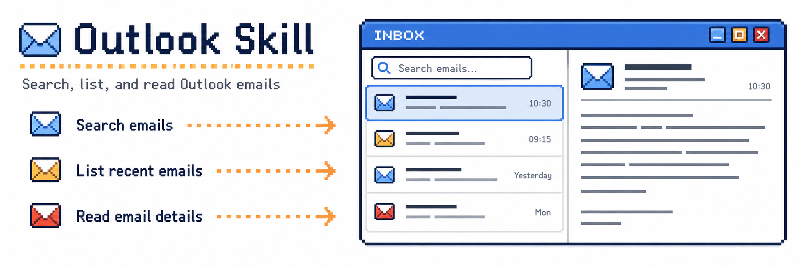

<div align="center">

# Outlook MCP



**A small, secure bridge between an Outlook mailbox and an AI agent.**

An MCP server and a Node CLI over Microsoft Graph: search, list and read email,
and write a draft that a person then sends. Device-code sign-in, silent token
refresh, and JSON that is easy for people and agents to use.

</div>

> [!IMPORTANT]
> This skill only covers the Outlook email tasks that match my personal needs,
> and it deliberately stops short of sending. This can evolve with time, don't
> hesitate to contribute 🤝

## Contents

- [What it is](#what-it-is)
- [Which way to run it](#which-way-to-run-it)
- [Install](#install)
- [For agents](#for-agents)
- [Run it in a container](#run-it-in-a-container)
- [Sign in](#sign-in)
- [The tools](#the-tools)
- [From a shell](#from-a-shell)
- [Configuration](#configuration)
- [When something is wrong](#when-something-is-wrong)
- [Security](#security)
- [Removing it](#removing-it)
- [Development](#development)
- [Releases](#releases)
- [License](#license)

## What it is

- **An MCP server first.** Start it with no arguments and it serves
  [Model Context Protocol](https://modelcontextprotocol.io) over stdio, so any
  client that can launch a stdio server gets the tools: Claude Code, Claude
  Desktop, Codex, VS Code and Copilot, Cursor, Gemini CLI, OpenCode, Pi, and
  plain harnesses of your own.
- **Or in a container, over HTTP.** `serve --http` speaks the same protocol over
  a Streamable HTTP endpoint, which is what the published image runs: one
  long-lived container, a URL any client can reach. See
  [Run it in a container](#run-it-in-a-container).
- **A CLI for humans and for clients without MCP.** The same core, driven by
  `node dist/index.js emails list`.
- **One tool registry, defined once** in `src/tools.ts` and consumed by both
  surfaces, so what a client is told and what the code can do cannot drift.
- **Read, search, and draft. Never send.** No tool, endpoint or flag in this
  repository transmits mail. See [SECURITY.md](SECURITY.md).

## Which way to run it

| Situation                                                                                               | Run                                          | Go to                                           |
| ------------------------------------------------------------------------------------------------------- | -------------------------------------------- | ----------------------------------------------- |
| Your client launches a stdio MCP server — Claude Code, Codex, VS Code, Cursor, Gemini CLI, OpenCode, Pi | `node dist/index.js`                         | [Install](#install)                             |
| One long-lived server, or a client that takes a URL                                                     | `serve --http`, which is what the image runs | [Run it in a container](#run-it-in-a-container) |
| No MCP at all: a shell, a cron job, a harness of your own                                               | `node dist/index.js emails list`             | [From a shell](#from-a-shell)                   |

Three prerequisites, and the third is not yours to satisfy:

- **Node 22 or newer** — `node --version`. `engines.node` says it too, and
  `engines` is a warning rather than a guard. 22.18+ additionally lets
  `node src/index.ts` run the sources without building first.
- **git**, for the clone.
- **An Application (client) ID** from a Microsoft Entra app registration — a
  browser, and a person, which is why it is asked for rather than built.

## Install

Installing from GitHub is the only supported path, and building it yourself is
the part that makes that dependable:

```bash
git clone https://github.com/vincentkelleher/outlook-mcp
cd outlook-mcp
npm ci
npm run build
export OUTLOOK_OAUTH_CLIENT_ID=your-application-client-id
```

`npm ci` needs no client id; it just installs. The one-time Microsoft-side
setup — an Entra ID app registration, public client flows, and the delegated
permissions — is written for an agent to follow in
[skills/outlook-mcp/references/setup.md](skills/outlook-mcp/references/setup.md),
and that file is the only copy of those steps.

Then tell your client where the server is. `config` resolves this checkout's
own absolute path and prints the snippet that client actually reads:

```bash
node dist/index.js config codex          # print it
node dist/index.js config claude-code --write   # merge it into the user config
```

Clients: `pi`, `claude-code`, `claude-desktop`, `codex`, `vscode`, `cursor`,
`gemini-cli`, `opencode`, `docker`, `generic`. The per-client matrix, the add commands,
the timeout units and the honest list of what is unverified live in
[docs/clients.md](docs/clients.md).

## For agents

Two installs, and only one of them is the code:

```bash
# 1. the instructions: SKILL.md and its two references
npx skills add vincentkelleher/outlook-mcp --skill outlook-mcp -a <client> -g -y

# 2. the server itself, wherever your client will launch it from
git clone https://github.com/vincentkelleher/outlook-mcp
cd outlook-mcp && npm ci && npm run build
```

`-a` names your client and `-y` is what stops the installer waiting for a
keyboard; without them `npx skills add` opens a picker and blocks, which looks
exactly like a hang. `--list` shows what a repository carries, `--all` takes
every skill and every detected client. The skills CLI needs Node 22.20+ and
copies the skill directory **only** — no `dist/` — so step 2 has to happen
before the `node dist/index.js …` that the skill tells you to run. No skills
CLI? The equivalent is a copy:
`cp -r outlook-mcp/skills/outlook-mcp ~/.claude/skills/`.

Then, in this order:

1. **The app registration is a person's job.** It happens in the Entra portal in
   a browser. You cannot do it and you must not invent a client id: ask for the
   Application (client) ID and stop until you have it.
2. **Register the server** with `node dist/index.js config <client>`, which
   prints the snippet with this checkout's absolute path resolved, or
   `--write` to merge it into that client's own file.
3. **Sign in without blocking**: the `login` tool, or
   `node dist/index.js login --background --json`. Show the `verificationUri`
   and the `userCode` it prints, then poll `auth status` (CLI) or `auth_status`
   (tool) until `signedIn`. Never start a second flow while one is live.
4. **Check it before you promise it**: `node dist/index.js auth status`, then
   `node dist/index.js emails list --limit 3`. `--version` names the release,
   which is how you tell a stale skill from a stale server.

Which tool answers which intent, pagination, attachments, the drafting rules and
the exact failure sentences are in
[skills/outlook-mcp/SKILL.md](skills/outlook-mcp/SKILL.md) and
[references/troubleshooting.md](skills/outlook-mcp/references/troubleshooting.md).
Nothing here can send mail: a draft gets written, a person sends it.

## Run it in a container

The image runs the server over Streamable HTTP on port 3939 and keeps nothing on
its own filesystem: the session and sign-in state live in `/data`, which is a
volume. Attachments use MCP resources by default and are not saved there; explicit
server-local downloads also live in `/data`.

```bash
docker run -d --name outlook-mcp \
  -p 127.0.0.1:3939:3939 \
  -v outlook-mcp-home:/data \
  -e OUTLOOK_OAUTH_CLIENT_ID=your-application-client-id \
  ghcr.io/vincentkelleher/outlook-mcp:latest

docker logs outlook-mcp
# Outlook MCP serving on http://127.0.0.1:3939/mcp
```

Then sign in through it. The device-code flow needs no port of its own, so a
browser on the host is enough and nothing has to be exposed for it:

```bash
docker exec outlook-mcp outlook login
# To sign in: https://microsoft.com/devicelogin  Enter the code ABC-XYZ123
```

And point a client at the URL — `node dist/index.js config docker` (or
`docker exec outlook-mcp outlook config docker`) prints it:

```json
{
  "mcpServers": {
    "outlook": { "type": "http", "url": "http://127.0.0.1:3939/mcp" }
  }
}
```

Four things about that command line are important:

- **`-p 127.0.0.1:3939:3939`, not `-p 3939:3939`.** The server inside the
  container binds the container's wildcard interface, because a loopback bind
  there is unreachable through a published port. The host side of the mapping is
  where the port stays local. Plain `-p` publishes it to your network, where
  `Host` and `Origin` checks will still refuse strangers — but refuse them from
  a port you did not mean to open.
- **`-v outlook-mcp-home:/data`, or you sign in again every time.** The token
  cache lives there, with the sign-in state. Two containers sharing a volume
  share one session, which is how `login` and `serve` find each other.
- **`OUTLOOK_OAUTH_CLIENT_ID` goes to the container.** The client entry carries a
  URL and no credentials; the app registration is the container's business.
- **Nothing on that port authenticates.** It is meant for your own machine.
  `GET /health` answers without touching Microsoft, so `docker ps` can report on
  it; `docker stop` takes it down in well under a second.

`latest` is what the docs use so they cannot go stale; pin `X.Y.Z` where a run
has to mean the same server twice. `node dist/index.js config docker` prints the
run command at the version of the code you have, not of these words.

Build it yourself with `docker build -t outlook-mcp .` — the same Dockerfile CI
publishes from. To use the image over stdio instead, drop `--http`:
`docker run -i --rm -v outlook-mcp-home:/data -e OUTLOOK_OAUTH_CLIENT_ID …
outlook-mcp serve`, which is the shape of it for a client that launches stdio
servers and will not take a URL.

## Sign in

```bash
node dist/index.js login
```

Follow the device-code prompt in a browser. The refreshable session is saved at
`~/.outlook-mcp/msal-cache.json`, directory `0700` and file `0600`, and shared
by the CLI and every MCP client on the machine. An agent signs in through the
`login` tool, which returns a URL and a code immediately rather than waiting for
a human, and polls `auth_status`. See
[skills/outlook-mcp/SKILL.md](skills/outlook-mcp/SKILL.md).

To stop: `node dist/index.js logout`, which deletes the saved session and
nothing else.

Coming from the name this project had before: the directory and its variable were
`.outlook-skill` and `OUTLOOK_SKILL_HOME`, and nothing reads that location any
more. `mv ~/.outlook-skill ~/.outlook-mcp` keeps the session; without it you sign
in again.

## The tools

Everything below is what `tools/list` advertises. The two writes — marking mail
read or unread, and drafts — appear only when the server is not in read-only
mode.

| Tool                   | What it does                                                               |
| ---------------------- | -------------------------------------------------------------------------- |
| `list_emails`          | One folder, newest first: `folder`, `unread`, `limit` ≤ 100, `cursor`      |
| `search_emails`        | Whole mailbox in Graph search syntax, `limit` ≤ 1000                       |
| `get_email`            | One message with its full plain-text body                                  |
| `list_attachments`     | Attachment metadata only: id, name, type, size, isInline                   |
| `download_attachment`  | Returns a session-scoped MCP resource link; server-local saving is opt-in  |
| `auth_status`          | Session, authority, cache path, mode, scopes, last sign-in error           |
| `login`                | Starts sign-in and returns at once with the URL and code                   |
| `logout`               | Deletes the saved session (marked destructive)                             |
| `mark_read`            | Sets `isRead` on 1-100 message ids, each id reported back                  |
| `mark_unread`          | Clears `isRead` on 1-100 message ids, the same shape                       |
| `create_draft`         | A new unsent message, read back as stored                                  |
| `create_reply_draft`   | An unsent reply that keeps the thread                                      |
| `create_forward_draft` | An unsent forward, to the recipients you name                              |
| `update_draft`         | Changes an unsent draft in place, only the fields you name                 |
| `list_drafts`          | What is already sitting in Drafts                                          |
| `delete_draft`         | Removes a draft (marked destructive)                                       |
| `add_attachment`       | Puts a file on a draft: base64, a server file, or a copy of a received one |
| `remove_attachment`    | Takes one file back off a draft (marked destructive)                       |

This table is the registry's own: `test/docs.test.ts` fails a build when a tool
appears in `src/tools.ts` and not here, or the other way round.

List results carry `items` and, when there is more to read, `nextCursor` — pass
it back as `cursor`. Resources are published too: `outlook://folders`,
`outlook://inbox`, and `outlook://messages/{id}`.

### Attachment resources

Call `download_attachment` with `messageId` and `attachmentId` to receive an MCP
`resource_link` to `outlook://attachments/<opaque-handle>` (also described in
`structuredContent`). Call `resources/read` with that URI to retrieve its binary
content as a base64 `blob`. This uses the existing MCP connection: no download
URL, reverse proxy, shared volume, or server-side file is needed.

The client must support resource links and resource reads. If the agent needs a
local file, its MCP integration must decode and save the blob in the **client's**
workspace, preferably without putting base64 into model context. MCP resources
do not automatically create client-side files.

Links belong to the connection/session that issued them, and expire when that
session closes or is retired for inactivity. After reconnecting in a new session,
call `download_attachment` again. Content is retrieved from Graph on every read,
not cached; deletion or revoked access can make a previously issued link unreadable.
Each session holds at most 1024 distinct attachment handles; repeated requests for
the same attachment reuse its handle.

The default decoded size limit is **20 MiB**, configurable with
`OUTLOOK_MCP_MAX_ATTACHMENT_BYTES`. Metadata is checked before fetching content,
and actual decoded size is checked before returning it. Base64 adds roughly 33%
to the response size; clients may impose lower response limits. Resource reads
are not chunked binary streaming, and Graph's JSON response is buffered in memory.

For compatibility, `delivery: "server_file"` explicitly saves inside
`OUTLOOK_MCP_ATTACHMENT_DIR` and returns a **server-local** path; `dir` requires
this mode. `encoding: "base64"` explicitly returns inline content up to 64 KiB
(without writing a file unless `server_file` was also selected). Oversized inline
requests fail with an actionable error, never silently fall back to a path.
This changes the previous default: clients relying on a returned filesystem path
must now request `delivery: "server_file"`.

### Putting files on a draft

`add_attachment` takes **exactly one source**, and which one you pick decides
whether the file ever enters the conversation:

| Source           | Bytes in the transcript | Notes                                                                   |
| ---------------- | ----------------------- | ----------------------------------------------------------------------- |
| `fromAttachment` | no                      | copies an attachment this mailbox already has                           |
| `serverPath`     | no                      | a file inside `OUTLOOK_MCP_ATTACHMENT_DIR`, streamed 3.75 MiB at a time |
| `contentBase64`  | **yes**                 | for a file the conversation already holds; needs `name`                 |

`download_attachment delivery: "server_file"` writes where `serverPath` reads,
so a received file can be re-attached without its bytes crossing a model — and
that is the whole of it: `serverPath` is confined to the attachment directory, so
an absolute path, a `..` or a symlink is refused before anything is opened. A
remote client has no files on the server, so it uses `fromAttachment`.

Graph takes a file in **one request under 3 MB** and by **upload session above
it**; either way nothing lands on the draft unless every byte was accepted, so a
failed call leaves the draft as it was and the answer says which route it took
(`attachment.transport`). The ceiling is `OUTLOOK_MCP_MAX_UPLOAD_BYTES` —
**35 MiB** by default, 150 MB at most, which is what Graph takes. The default is
the mailbox's own limit rather than Graph's on purpose: a 140 MB attachment would
upload happily and then fail at Send, when the user is least able to do anything
about it.

Both attachment tools refuse a target Graph reports as **not a draft**: an
attachment can be added to a sent message through Graph, and this server will not
do that, in either direction. `remove_attachment` is marked destructive for the
same reason `delete_draft` is — the file leaves the draft and there is no undo —
and every answer lists the draft's attachments with their ids, so the id the next
call needs is already in the last one.

### Nothing here can send mail

There is no `/send`, no `/reply`, no `/forward`, and no `Mail.Send` scope. A
draft is a message waiting in your Drafts folder for a person to read and send.
The only other write is a message's read flag — one `PATCH` of `isRead`, which
changes no content and transmits nothing:

- The draft tools are annotated so clients ask before running them.
- Recipients are only ever the addresses you pass. Nothing reads the mailbox to
  guess who to mail.
- Every draft result reads back what Microsoft actually stored, so the human can
  audit it.
- An attachment write reads its target first and refuses a message Graph says is
  not a draft, so a message that has been sent keeps the files it went out with.
- Tests assert the registry contains no send-capable tool and that no request
  path ends in `/send`, `/reply` or `/forward`, and they pin every mutating
  Graph call: eight on a draft, one `PATCH` of `isRead`, and the upload-session
  chunk `PUT` that the verb scan cannot see.

If sending ever becomes a feature, it needs its own scope, its own confirmation,
and its own conversation.

## From a shell

```bash
node dist/index.js emails list
node dist/index.js emails list --unread --limit 25
node dist/index.js emails search "from:hello@example.com" --limit 25
node dist/index.js emails get "message-id"
node dist/index.js emails attachments "message-id"
node dist/index.js emails read "message-id" "another-id"
node dist/index.js emails unread "message-id"
node dist/index.js auth status
node dist/index.js --version
node dist/index.js config --help
```

`auth status` is the CLI half of the `auth_status` tool — the session, the mode,
the scopes, and the URL and code of a sign-in another client started — so a
shell has a way to ask that question without firing a command that needs a
session. It exits 0 either way; branch on `.signedIn`.

Email commands print JSON on stdout and keep diagnostics on stderr, so they
compose:

```bash
node dist/index.js emails list --limit 5 | jq '.[].subject'
```

`list` returns up to 100 messages and `search` up to 1000, in Microsoft Graph
message-search syntax including `from:`, `subject:` and `body:`. `emails
attachments` is the one place that still prints base64 `contentBytes`, because
that is what the CLI always did; the MCP tools never do. `emails read` and
`emails unread` take 1 to 100 ids and print what Graph says each one now
carries, including the ids it refused.

## Configuration

| Variable                           | Default                  | Purpose                                                                                                                                                    |
| ---------------------------------- | ------------------------ | ---------------------------------------------------------------------------------------------------------------------------------------------------------- |
| `OUTLOOK_OAUTH_CLIENT_ID`          | — (required)             | The Application (client) ID from your app registration.                                                                                                    |
| `OUTLOOK_OAUTH_TENANT`             | `consumers`              | `common` or `organizations` for a work or school mailbox.                                                                                                  |
| `OUTLOOK_MCP_HOME`                 | `~/.outlook-mcp`         | Where the token cache lives.                                                                                                                               |
| `OUTLOOK_MCP_STATE_DIR`            | `~/.outlook-mcp/state`   | Sign-in state: the URL, the code, the last error. Never a token.                                                                                           |
| `OUTLOOK_MCP_ATTACHMENT_DIR`       | `$TMPDIR/outlook-mcp`    | Allowed directory for explicit `delivery: "server_file"` downloads.                                                                                        |
| `OUTLOOK_MCP_MAX_ATTACHMENT_BYTES` | `20971520`               | Maximum decoded MCP attachment download/resource size in bytes (20 MiB); positive integer.                                                                 |
| `OUTLOOK_MCP_MAX_UPLOAD_BYTES`     | `36700160`               | Maximum file `add_attachment` will put on a draft (35 MiB); at most 150 MiB, which is Graph's own ceiling.                                                 |
| `OUTLOOK_MCP_READONLY`             | unset                    | Read-only: hides every write (draft tools and read flags) and asks Microsoft for `Mail.Read`.                                                              |
| `OUTLOOK_MCP_HOST`                 | `127.0.0.1`              | `serve --http` only: the interface to bind. The image sets `0.0.0.0`; see the note below.                                                                  |
| `OUTLOOK_MCP_PORT`                 | `3939`                   | `serve --http` only: the port to bind. `--port` overrides it, and accepts `0` for a free one.                                                              |
| `OUTLOOK_MCP_ALLOWED_HOSTS`        | unset                    | Extra `Host` names to serve, comma-separated, for a server reached by a name of your own.                                                                  |
| `OUTLOOK_MCP_ALLOWED_ORIGINS`      | unset                    | Extra browser origins, comma-separated, beyond the same origin.                                                                                            |
| `OUTLOOK_MCP_SESSION_IDLE_MINUTES` | `1440`                   | `serve --http` only: how long an HTTP session with nothing connected survives. A full house of 32 gives up its longest-idle session to admit a new client. |
| `OUTLOOK_MCP_IMAGE`                | the published GHCR image | Which image `config docker` names, if you mirror it elsewhere.                                                                                             |
| `OUTLOOK_LOG_LEVEL`                | `info`                   | `debug`, `info`, `warn`, `error` or `silent`. Every log line goes to stderr.                                                                               |
| `OUTLOOK_LOG_FORMAT`               | `text`                   | `text` for a terminal, `json` for a log collector.                                                                                                         |

A `.env` in the working directory is read for you, and real environment
variables win over it.

The four HTTP variables that decide who may connect — `OUTLOOK_MCP_HOST`,
`OUTLOOK_MCP_ALLOWED_HOSTS`, `OUTLOOK_MCP_ALLOWED_ORIGINS` and the bind itself —
are checked on every request, because the transport authenticates nobody. The
`Host` must be a loopback address or one you named, and a browser `Origin` must
be the origin the request was addressed as; a request carrying neither header is
a native MCP client, which is the ordinary case. Without that rule, a page any
browser visits could re-resolve `localhost` and read your mail through a port you
left open, which is what [SECURITY.md](SECURITY.md) is about. So: a container on
`0.0.0.0` behind `-p 127.0.0.1:3939:3939` is local, and a name that is not the
machine's own is refused from either side.

`OUTLOOK_MCP_READONLY` is an environment variable and deliberately not a flag. A
flag on `serve` but not on `login` would leave a token holding `Mail.ReadWrite`
behind a surface advertising read-only, or the reverse: one decision, made before
any command runs, is the only way the permissions and the advertised tools cannot
disagree. `auth_status` always reports the effective mode and scopes.

### Reading the logs

Every command, tool call, sign-in and session writes a line to stderr — never to
stdout, which is JSON-RPC on stdio and JSON for `jq` in a shell:

```bash
OUTLOOK_LOG_LEVEL=debug node dist/index.js emails search "from:ana" --limit 5
node dist/index.js serve --http 2> ~/outlook-mcp.log     # info by default
tail -f ~/outlook-mcp.log
```

A line says when, how loud, which module, what happened, and the scalars that
explain it. This is an MCP session over HTTP at the default level:

```text
2026-01-14T09:12:04.334Z info 41802 http: session opened sessionId=6f1c0b0e-2d59-4a1e-9a4f-3b7f0c2d1e55 sessions=1 readonly=false
2026-01-14T09:12:04.356Z info 41802 mcp: tool call sessionId=6f1c0b0e-2d59-4a1e-9a4f-3b7f0c2d1e55 tool=search_emails queryChars=31 limit=5
2026-01-14T09:12:04.357Z info 41802 auth: session check confirmed a session account=v***@example.com ms=188
2026-01-14T09:12:05.087Z info 41802 mcp: tool call completed sessionId=6f1c0b0e-2d59-4a1e-9a4f-3b7f0c2d1e55 tool=search_emails ms=731 bytes=1642 items=5
```

and the same call at `debug`, where the Microsoft Graph request is visible:

```text
2026-01-14T09:12:04.361Z debug 41802 graph: graph request method=GET path=/me/messages ms=724 items=5
```

A sign-in that expired explains itself, and the recovery after it is two lines
that read as one story:

```text
2026-01-14T09:12:41.203Z warn 41802 auth: silent token refresh failed account=v***@example.com problem=expired ms=412 reason="AADSTS700082: ..."
2026-01-14T09:12:41.688Z info 41802 login: Microsoft issued a device code verificationUri=https://microsoft.com/devicelogin userCode=HKDF*** expiresIn=900
```

- **`info`** (the default): one line per command or tool call, per sign-in, per
  HTTP session, plus every warning and error.
- **`debug`**: adds the Microsoft Graph calls with their verb, path, duration and
  item counts, the token-cache reads and writes, and the message ids, file paths,
  search queries and full addresses a call named. That is the level for
  reproducing one call.
- **`warn`** and **`error`**: only what needs reading. A missing session is a
  warning, because a tool call fixes it; anything else is an error, because
  nobody has read it yet.
- **`silent`**: nothing.

Mail itself never travels in a log line at any level: no body, no attachment
content, no token, ever — those keys are struck out before a line is written.
Sender addresses are masked, a message id is shortened to eight characters and a
search query appears as its length until you ask for `debug`, because stderr is
not owner-only: a container log, a CI artefact and a pasted terminal are all
places mail can end up without anyone deciding that.

`OUTLOOK_LOG_FORMAT=json` writes one pino record per line for a collector
(`level`, `time`, `pid`, `scope`, `msg`, then the fields); the same redaction
applies, because the text format is rendered from that record.

## When something is wrong

[skills/outlook-mcp/references/troubleshooting.md](skills/outlook-mcp/references/troubleshooting.md)
is the full table and it ships inside the skill, because that is the file an
agent has when the repository is not on disk. It is keyed on the sentence you are
reading. The short version, in the order an agent usually meets it:

| Sentence                                                          | Meaning and fix                                                                                                                                      |
| ----------------------------------------------------------------- | ---------------------------------------------------------------------------------------------------------------------------------------------------- |
| `No Outlook session. Run the login command first.`                | Nothing cached. Start a sign-in, show the URL and code, poll `auth status`.                                                                          |
| `Outlook session needs re-authorisation …`                        | The cached grant is narrower than this process asks for. Sign in again — and check the app carries `Mail.ReadWrite` before you spend a consent flow. |
| `Could not confirm the Outlook session … no re-consent is needed` | The check failed, not the session: network or Microsoft. Retry later; a device-code flow needs the same network and is rate-limited.                 |
| `AADSTS700016` / `unauthorized_client`                            | The registration is not a public client, or the client id is wrong. See [setup.md](skills/outlook-mcp/references/setup.md).                          |
| `A sign-in is already running as process N …`                     | Somebody else holds the live code. Poll for it; do not start a second one.                                                                           |
| Draft tools missing from `tools/list`                             | `OUTLOOK_MCP_READONLY` is on. One decision, made before any command runs, which is why it is not a flag.                                             |

Run the failing command once with `OUTLOOK_LOG_LEVEL=debug` if the sentence is
not enough: the line before the failure names the step, and usually Microsoft's
own reason.

## Security

Public client with no secret, an owner-only token cache written atomically, no
telemetry, and mail content going only to the model you are already talking to.
Scopes, cache modes, attachment limits and the reasoning behind the no-send
design are in [SECURITY.md](SECURITY.md).

## Removing it

```bash
node dist/index.js logout           # the token cache and the sign-in state, nothing else
npx skills remove outlook-mcp -g -y # if you installed the skill
rm -rf outlook-mcp                  # the checkout
```

`logout` deletes `~/.outlook-mcp` contents and does not touch mail. The server
writes no other state, and the entry it added to your client's configuration file
is yours to delete — `config <client>` prints it, so you can see which file to
clean, and `--write` only ever added one key under that client's own server map. A
container takes its volume with it: `docker rm outlook-mcp` then
`docker volume rm outlook-mcp-home`.

## Development

Node only, and `engines.node` says 22 — the two versions CI and the image are
built on. There is no Bun, no npm publish, and no build step while iterating:
`node` runs the TypeScript sources directly through native type stripping
(Node 22.18+ or 23.6+), and `npm run build` compiles `dist/` — what ships, what
clients launch, and what a Node below 22.18 runs instead.

```bash
npm run format        # prettier
npm run format:check
npm run typecheck     # tsc, noEmit, strict, erasableSyntaxOnly
npm test              # node --test on the sources
npm run test:e2e      # spawns the entry over real stdio
npm run build         # dist/, which is what clients launch
```

Unit tests never reach Microsoft: `createAuth({ msal })` and
`createGraph({ token, client })` take fakes. The e2e suite spawns the real entry
and asserts the MCP handshake and that nothing but JSON-RPC reaches stdout. CI
runs Node 22 and 24 through the whole list, and packs and inspects the release
tarball.

`docs/plans/` holds the design records behind two shipped decisions. They are
history, they disagree with the code in places, and nothing that ships cites
them: `test/clients.test.ts` asserts that, and `test/docs.test.ts` asserts that
the documentation still names every tool, every environment variable and no stale
image tag. Where a plan and a README disagree, the README is right.

## Releases

The version follows the commit messages on `main`, and `.releaserc.yaml` holds
the rules: `fix:` is a patch, `feat:` a minor, and a `!` after the type or a
`BREAKING CHANGE:` footer a major. `chore:`, `docs:`, `test:` and `ci:` cut
nothing, so a branch that only tidies up asks for no ceremony. A merge commit
carries no release of its own — what is read is the commits it brings in, so the
`feat:` belongs on the commit and not in the merge message.

`.github/workflows/release.yml` runs once the checks on `main` have passed, and
when a commit qualified it pushes the tag, writes the new version into
`package.json` — the file `/health` and the MCP `initialize` reply both read —
and opens the GitHub Release that is this project's changelog. There is no
`CHANGELOG.md` to keep in step by hand, and no npm publish: the image on
`ghcr.io/vincentkelleher/outlook-mcp` is the distribution, and `docker.yml`
publishes `X.Y.Z`, `X.Y` and `latest` for it: a numeric tag means the release, not
the build that happens to share a number.

So no version is cut for code the checks rejected, and none for a commit that
was overtaken: when main moves while CI is running, the release waits for that
commit's own checks, and one release covers both. The chain is
CI → Release → Docker, and a Release run that was skipped says one of those two
things happened.

A tag pushed with the workflow token starts no run of its own, which is the only
reason those two workflows speak at all: the version travels from the Release run
to `docker.yml` as an artefact. `v0.1.0` is the baseline — everything before it
was versioned by hand, and the analysis counts from that tag forward.

## License

MIT — see [LICENSE](LICENSE).
